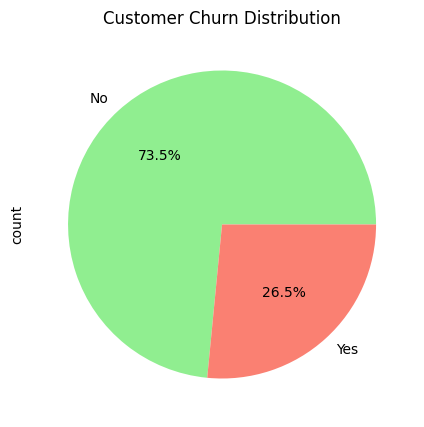
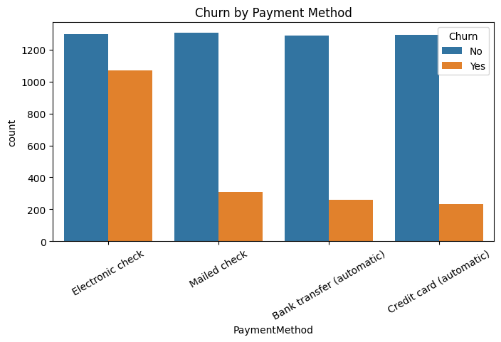
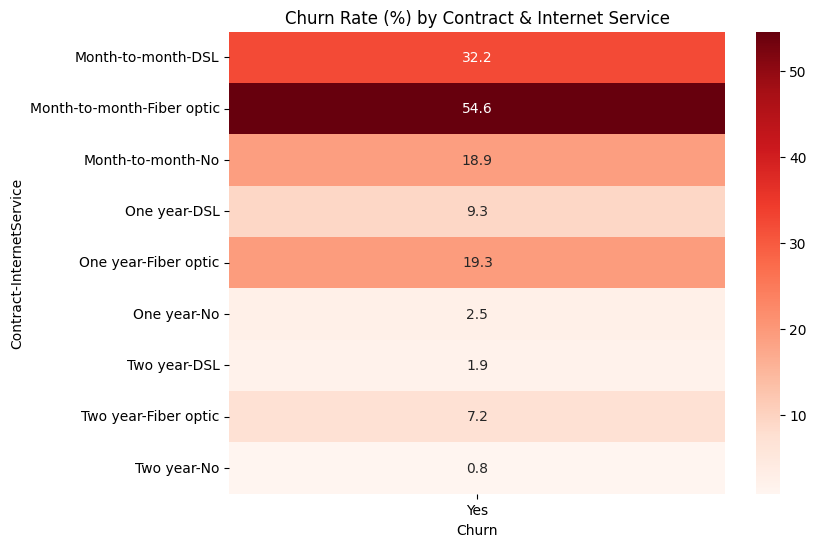
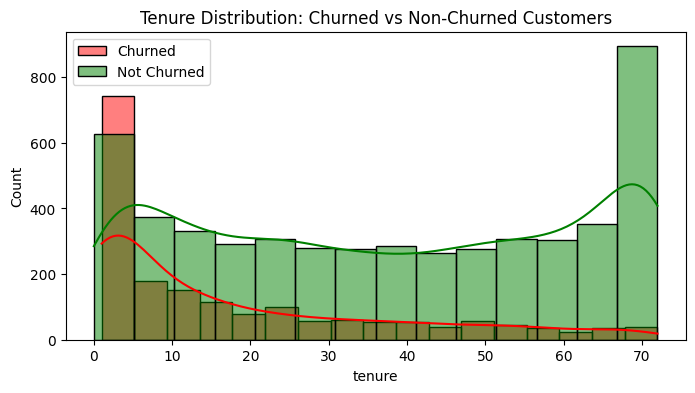

# Telco Customer Churn Analysis


Exploratory data analysis of **7,043 telecom customers** to find out **who churns and why**, and what a business could do about it. Done in Python with pandas, Matplotlib and Seaborn.

## Business problem

Keeping a customer is usually cheaper than winning a new one. About **1 in 4 customers (26.5%) left** in this dataset, so the question is: which customers are most at risk, and what do they have in common?

## Key findings

| Finding | Evidence |
|---|---|
| **Contract type is the strongest signal** | Month-to-month customers churn at **42.7%**, one-year at **11.3%**, two-year at **2.8%** |
| **Fiber optic customers churn the most** | **41.9%** vs 19.0% for DSL and 7.4% for customers with no internet |
| **Electronic check payers leave far more often** | **45.3%** churn, compared with 15-19% for every other payment method |
| **New customers are the most fragile** | Churned customers stayed **18 months** on average vs **37.6** for loyal ones; customers in their first 6 months churn at **52.9%** |
| **Higher bills, higher churn** | Average monthly charge is **$74.40** for churned customers vs **$61.30** for those who stayed |
| **Senior citizens churn much more** | **41.7%** vs 23.6% for non-seniors |
| **Worst combination** | Month-to-month **and** fiber optic: **54.6%** churn across 2,128 customers |
| **Gender makes no real difference** | 26.9% (female) vs 26.2% (male) |

## Charts

<p align="center">
  
  
</p>
<p align="center">
  
  
</p>

## Business recommendations

- **Move customers onto longer contracts** with a discount or perk. Contract length separates churners from loyal customers more than anything else.
- **Look at fiber optic quality and pricing.** Fiber users are charged more and churn twice as often as DSL users.
- **Nudge electronic-check customers to automatic payment** (card or bank transfer), which has less than half the churn.
- **Invest in the first 6 months.** Onboarding calls, check-ins or a first-year offer target the highest-risk window.
- **Run a retention offer for senior citizens**, who leave at almost twice the rate of other customers.

## Dataset

[IBM Telco Customer Churn](https://www.kaggle.com/datasets/blastchar/telco-customer-churn) sample dataset (public, fictional telecom company): **7,043 customers, 21 columns**.

| Group | Columns |
|---|---|
| Demographics | `gender`, `SeniorCitizen`, `Partner`, `Dependents` |
| Services | `PhoneService`, `MultipleLines`, `InternetService`, `OnlineSecurity`, `OnlineBackup`, `DeviceProtection`, `TechSupport`, `StreamingTV`, `StreamingMovies` |
| Account and billing | `tenure`, `Contract`, `PaperlessBilling`, `PaymentMethod`, `MonthlyCharges`, `TotalCharges` |
| Target | `Churn` (Yes / No) |

## Method

1. Convert `TotalCharges` to numeric. 11 blank values appear (new customers with tenure 0), and they are filled with the median.
2. Turn `SeniorCitizen` from 0/1 into No/Yes so it reads like the other columns.
3. Drop `customerID`, which carries no information for analysis.
4. Merge "No internet service" and "No phone service" into "No".
5. Check for missing values and duplicates, then save the cleaned data to `data/processed/`.
6. Explore churn by demographics, services, billing and tenure, using counts, rates, distributions and heatmaps.

## Project structure

```
customer-churn-analysis/
├── data/
│   ├── raw/telco_customer_churn.csv            # original dataset
│   └── processed/telco_customer_churn_cleaned.csv   # output of the notebook
├── notebooks/
│   └── 01_telco_churn_eda.ipynb                # full analysis with charts
├── images/                                     # charts used in this README
├── requirements.txt
└── README.md
```

## How to run

```bash
git clone https://github.com/MohanNellore/Customer-Churn-Analysis.git
cd Customer-Churn-Analysis
python -m venv venv
source venv/bin/activate          # Windows: venv\Scripts\activate
pip install -r requirements.txt
jupyter notebook notebooks/01_telco_churn_eda.ipynb
```

Run all cells from top to bottom. The notebook reads from `data/raw/` and writes the cleaned file to `data/processed/`.

## Next steps

- Train a churn prediction model (for example logistic regression) and compare it with a baseline.
- Build an interactive Power BI dashboard on the cleaned data.

## Author

**Mohan Nellore**: [GitHub](https://github.com/MohanNellore) | [Portfolio](https://mohannellore.github.io)
